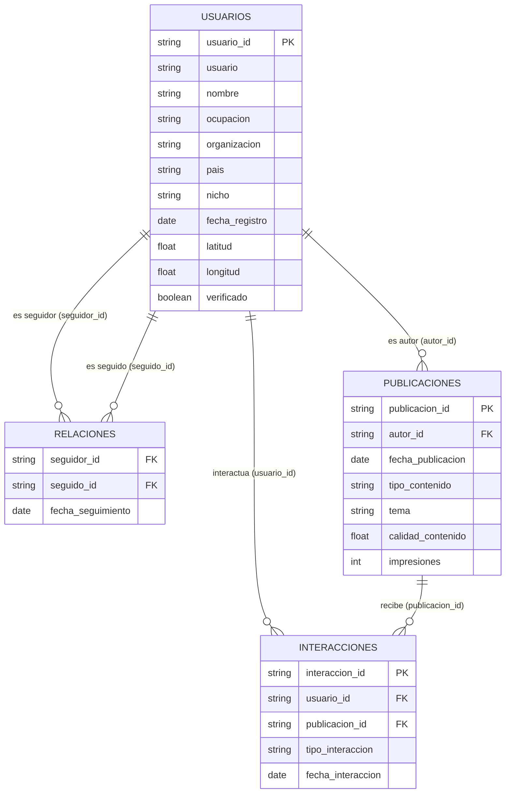

# Diccionario de Datos del Proyecto BI: Influenciadores y Seguidores

**Fecha de diagnóstico:** 27 de octubre de 2026  
**Ubicación de fuentes:** `data/raw/`  
**Estado de la fuente:** Datos inmutables / Fuente de Verdad  

---

## 1. Inventario General de Archivos Crudos

| Archivo | Filas (Registros) | Columnas | Tamaño en Disco | Codificación Real | Propósito Principal |
| :--- | :---: | :---: | :---: | :---: | :--- |
| `usuarios.csv` | 650 | 11 | 90.3 KB | ISO-8859-1 (Latin1) | Dimensión maestra de perfiles de usuario y metadatos demográficos/geográficos. |
| `relaciones.csv` | 8,133 | 3 | 227.8 KB | ISO-8859-1 (Latin1) | Grafo dirigido de conexiones seguidor → seguido (red social). |
| `publicaciones.csv` | 5,200 | 7 | 291.8 KB | ISO-8859-1 (Latin1) | Contenido generado por los usuarios (posts), temática, calidad e impresiones. |
| `interacciones.csv` | 35,810 | 5 | 1.81 MB | ISO-8859-1 (Latin1) | Registro transaccional de engagement (likes, comentarios, compartidos, guardados). |
| `diccionario_datos.csv` | 7 | 3 | 476 bytes | ISO-8859-1 (Latin1) | Glosario fuente provisto en el repositorio original. |

---

## 2. Detalle de Tablas y Columnas

### 2.1. `usuarios.csv` (Dimensión Usuario)
Contiene la base de perfiles registrados en la red.
- **Clave Primaria (PK):** `usuario_id` (Única: 650 valores distintos sobre 650 filas).
- **Valores Nulos:** 0 en todas las columnas (100% completitud).

| Columna | Tipo Detectado | Clave | Valores Únicos | Ejemplos Observables | Descripción del Negocio |
| :--- | :--- | :---: | :---: | :--- | :--- |
| `usuario_id` | String (`VARCHAR`) | **PK** | 650 | `USR0001`, `USR0002`, `USR0650` | Identificador alfanumérico único del perfil. |
| `usuario` | String (`VARCHAR`) | UQ | 650 | `raquelziemannd0001`, `danelleromague0002` | Nombre de cuenta / handle de la red. |
| `nombre` | String (`VARCHAR`) | - | 650 | `Raquel Ziemann DDS`, `Danelle Romaguera` | Nombre completo de la persona. |
| `ocupacion` | String (`VARCHAR`) | - | 416 | `Medical laboratory scientific officer`, `Oceanographer` | Profesión o rol declarado. |
| `organizacion` | String (`VARCHAR`) | - | 643 | `Fritsch Ltd`, `Dicki-Luettgen`, `Price, Senger and Reinger` | Empresa u organización de filiación. |
| `pais` | Categoría (`VARCHAR`) | - | 5 | `Bolivia` (264), `Perú` (111), `Colombia` (95), `Argentina` (90), `Chile` (90) | País de origen/residencia. |
| `nicho` | Categoría (`VARCHAR`) | - | 6 | `Gastronomía` (123), `Viajes` (115), `Educación` (111), `Moda` (108), `Deportes` (98), `Tecnología` (95) | Sector de especialidad o interés temático del usuario. |
| `fecha_registro` | Fecha (`YYYY-MM-DD`) | - | 571 | `2018-01-05` a `2026-06-23` | Fecha en que se creó la cuenta. |
| `latitud` | Float (`FLOAT64`) | - | 650 | `-89.47329` a `89.43105` | Coordenada geográfica simulada. |
| `longitud` | Float (`FLOAT64`) | - | 650 | `-179.80911` a `179.91422` | Coordenada geográfica simulada. |
| `verificado` | Booleano (`BOOLEAN`)| - | 2 | `FALSE` (499, 76.8%), `TRUE` (151, 23.2%) | Indicador de cuenta verificada oficialmente. |

---

### 2.2. `relaciones.csv` (Red Social - Grafo Dirigido)
Representa los enlaces dirigidos de la red: `seguidor_id` sigue a `seguido_id`.
- **Clave Primaria Compuesta:** (`seguidor_id`, `seguido_id`).
- **Valores Nulos:** 0 (100% completitud).
- **Duplicados:** 0 aristas duplicadas.

| Columna | Tipo Detectado | Clave | Valores Únicos | Ejemplos Observables | Descripción del Negocio |
| :--- | :--- | :---: | :---: | :--- | :--- |
| `seguidor_id` | String (`VARCHAR`) | **FK** | 650 | `USR0001`, `USR0003` | Perfil que emite el seguimiento (iniciador). |
| `seguido_id` | String (`VARCHAR`) | **FK** | 650 | `USR0605`, `USR0346` | Perfil que es seguido (receptor / potencial influencer). |
| `fecha_seguimiento` | Fecha (`YYYY-MM-DD`) | - | 1,685 | `2022-01-01` a `2026-08-28` | Momento temporal en que se estableció el follow. |

---

### 2.3. `publicaciones.csv` (Hechos de Contenido)
Catálogo de posts emitidos por los usuarios.
- **Clave Primaria (PK):** `publicacion_id` (Única: 5,200 valores sobre 5,200 filas).
- **Valores Nulos:** 0 en todas las columnas.

| Columna | Tipo Detectado | Clave | Valores Únicos | Ejemplos Observables | Descripción del Negocio |
| :--- | :--- | :---: | :---: | :--- | :--- |
| `publicacion_id` | String (`VARCHAR`) | **PK** | 5,200 | `PUB000001`, `PUB005200` | Identificador unívoco del post. |
| `autor_id` | String (`VARCHAR`) | **FK** | 646 | `USR0137`, `USR0336` | Usuario creador del post. (646 de 650 usuarios han publicado al menos una vez). |
| `fecha_publicacion` | Fecha (`YYYY-MM-DD`) | - | 626 | `2024-01-01` a `2025-09-17` | Fecha de lanzamiento de la publicación. |
| `tipo_contenido` | Categoría (`VARCHAR`) | - | 4 | `Video` (1,789), `Imagen` (1,687), `Texto` (969), `Historia` (755) | Formato del post. |
| `tema` | Categoría (`VARCHAR`) | - | 6 | `Viajes` (920), `Educación` (887), `Moda` (887), `Gastronomía` (875), `Deportes` (835), `Tecnología` (796) | Eje temático del post. |
| `calidad_contenido`| Float (`FLOAT64`) | - | 720 | `0.100` a `0.900` (Media: 0.501) | Score cuantitativo sintético de calidad intrínseca del post. |
| `impresiones` | Entero (`INT64`) | - | 1,335 | `50` a `3,000` (Media: 1,482) | Volumen de visualizaciones brutas del post. |

---

### 2.4. `interacciones.csv` (Hechos Transaccionales de Engagement)
Registro de acciones individuales realizadas por usuarios sobre publicaciones.
- **Clave Primaria (PK):** `interaccion_id` (Única: 35,810 registros).
- **Valores Nulos:** 0 en todas las columnas.

| Columna | Tipo Detectado | Clave | Valores Únicos | Ejemplos Observables | Descripción del Negocio |
| :--- | :--- | :---: | :---: | :--- | :--- |
| `interaccion_id` | String (`VARCHAR`) | **PK** | 35,810 | `INT0000001`, `INT0035810` | Identificador unívoco del evento de engagement. |
| `usuario_id` | String (`VARCHAR`) | **FK** | 650 | `USR0152`, `USR0122` | Usuario que interactúa (consumidor/seguidor). |
| `publicacion_id` | String (`VARCHAR`) | **FK** | 5,082 | `PUB004027`, `PUB000827` | Publicación sobre la que recae la interacción (5,082 de 5,200 posts tienen engagement). |
| `tipo_interaccion` | Categoría (`VARCHAR`) | - | 4 | `Me_gusta` (23,121), `Comentario` (6,016), `Compartido` (3,713), `Guardado` (2,960) | Modalidad de engagement. |
| `fecha_interaccion`| Fecha (`YYYY-MM-DD`) | - | 640 | `2024-01-01` a `2025-10-01` | Fecha en la que ocurrió la interacción. |

---

## 3. Modelo Conceptual y Relacional

---

## 4. Hallazgos de Calidad, Integridad y Anomalías Observadas

1. **Integridad Referencial Perfecta (100%):**
   - Todos los `seguidor_id` y `seguido_id` existen en `usuarios.csv`.
   - Todos los `autor_id` en `publicaciones.csv` existen en `usuarios.csv`.
   - Todos los `usuario_id` en `interacciones.csv` existen en `usuarios.csv`.
   - Todos los `publicacion_id` en `interacciones.csv` existen en `publicaciones.csv`.
   - Cero auto-seguimientos (`seguidor_id == seguido_id`).
   - Cero auto-interacciones (`interaccion.usuario_id == publicacion.autor_id`).

2. **Codificación de Caracteres (Encoding):**
   - Los archivos crudos están grabados en `ISO-8859-1` (Latin1) / `Windows-1252`. Al abrirlos como `UTF-8` estricto surgen caracteres corruptos (mojibake) en tildes y eñes (ejemplo: `Perú` → `Perǧ`, `Educación` → `Educacin`). Los pipelines deben leer con `encoding='latin1'` y normalizar a `UTF-8` en la capa procesada.

3. **Inconsistencias Cronológicas en Datos Sintéticos:**
   - **Publicaciones antes del registro:** 1,098 de 5,200 publicaciones (21.1%) presentan una `fecha_publicacion` anterior a la `fecha_registro` del autor.
   - **Seguimientos antes del registro:** 2,334 de 8,133 relaciones (28.7%) tienen `fecha_seguimiento` anterior a la `fecha_registro` del seguidor.
   - *Diagnóstico BI:* Refleja la naturaleza sintética de los datos generados aleatoriamente. Para el cálculo analítico no invalida el grafo ni el engagement, pero debe quedar documentado como supuesto/limitación en la wiki.

4. **Estructura del Grafo y Reciprocidad:**
   - De 8,133 aristas dirigidas, solo existen 212 aristas recíprocas (106 pares bidireccionales, ~2.6%). El grafo es predominantemente asimétrico, típico de redes estilo Twitter/Instagram donde pocos creadores concentran seguidores pasivos.
